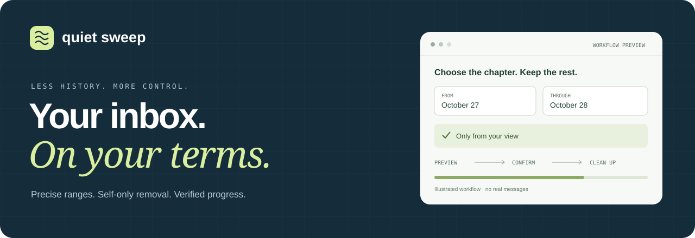
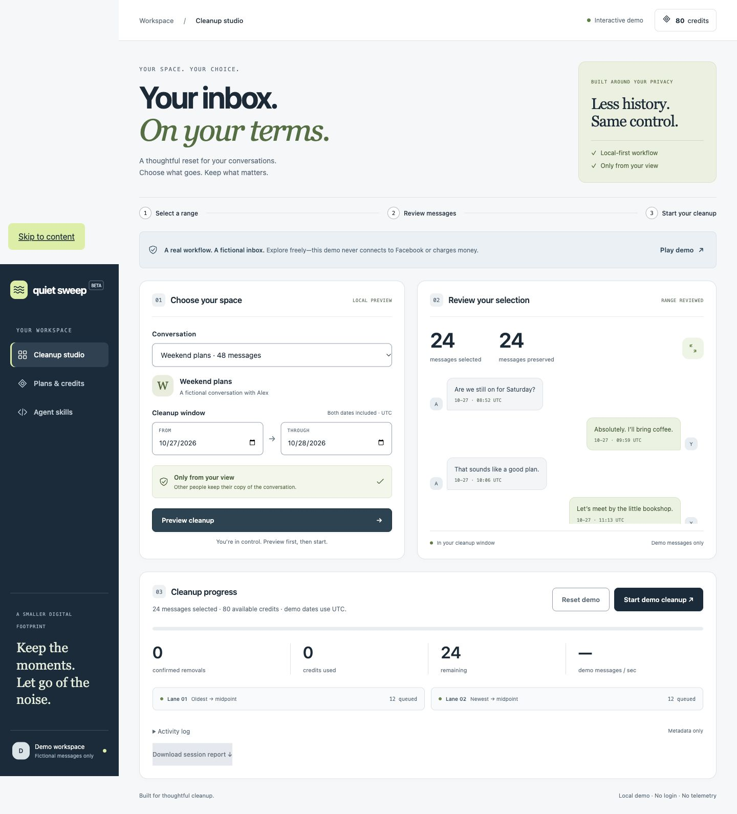
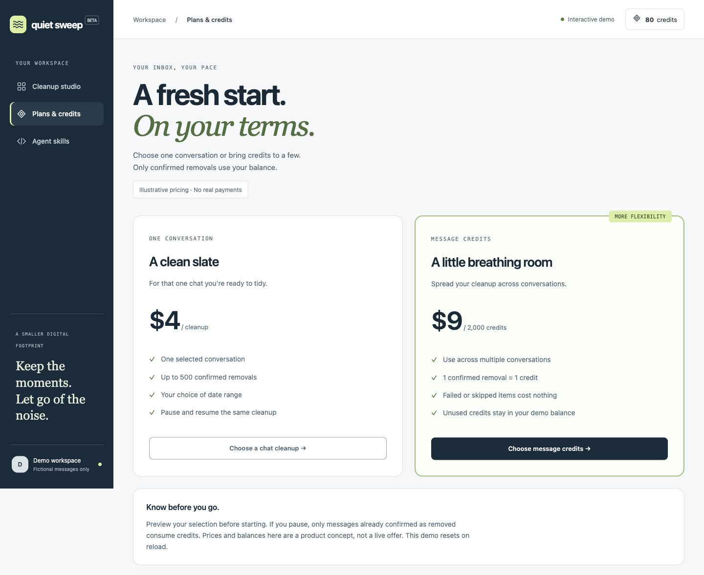
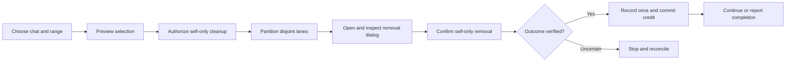

<div align="center">



### Keep the conversation. Clear the chapter.

A local-first Messenger cleanup toolkit that puts **scope, privacy, and control** before the delete button.

**Interactive product demo · Codex & Claude skill · Experimental browser adapter**

[Get started](#run-it-in-under-a-minute) · [Explore the interface](#a-workspace-built-for-control) · [Install the skill](#bring-your-agent) · [See the roadmap](#from-prototype-to-product)

</div>

---

> [!NOTE]
> **This is a working prototype, not a live paid service.** The dashboard uses fictional messages and simulated credits. It never connects to Facebook or collects payment. The skill requires an independently configured browser-capable agent; the reference adapter is experimental.

## Why Quiet Sweep?

Sometimes you want to remove a specific stretch of a conversation while keeping everything before it. Doing that message by message is tedious—and a whole-chat delete is too broad.

Quiet Sweep explores a more deliberate workflow: **choose a chat → define a range → review → remove from your view → verify.** It turns the lessons from a hands-on browser cleanup into reusable agent instructions, a tested planning engine, and an interface you can actually try.

<table>
<tr>
<td width="50%" valign="top">
<h3>01 / Precise by design</h3>
<p>Select an inclusive date range. Preview the messages selected and the history preserved. Two cleanup lanes work on disjoint portions of the plan.</p>
</td>
<td width="50%" valign="top">
<h3>02 / Your view only</h3>
<p>The workflow explicitly selects <strong>Unsend for you</strong> or <strong>Remove for you</strong>. Other participants keep their copy.</p>
</td>
</tr>
<tr>
<td valign="top">
<h3>03 / Progress you can account for</h3>
<p>Pause, resume, and export a session report. The demo ledger reserves credits and commits each confirmed removal once.</p>
</td>
<td valign="top">
<h3>04 / Useful beyond the demo</h3>
<p>Install the portable skill in Codex or Claude Code. Reuse the scope checks, recovery guidance, and completion criteria with supported browser tools.</p>
</td>
</tr>
</table>

## Run it in under a minute

**Node.js 20+ · zero npm dependencies · no account required for the demo**

```bash
git clone https://github.com/Mohammed-AB/quiet-sweep.git
cd quiet-sweep
npm start
```

Open **http://127.0.0.1:4173** and click **Play demo**.

The repository is public and free to clone. There is no `npm install` step. The local server binds to `127.0.0.1`.

**Try this first:** choose **Weekend plans**, select **October 27–28, 2026**, and preview. You should see **24 selected / 24 preserved**. Start, pause, resume, and download the report. All timestamps in the demo use UTC; state resets on reload.

## A workspace built for control

The studio brings selection, review, and progress into one flow. A high-contrast navigation rail becomes labeled bottom navigation on mobile. Date errors appear alongside the controls; cleanup progress is exposed to assistive technology.

<details open>
<summary><strong>Cleanup studio — select, review, and run</strong></summary>
<br>

</details>

<details>
<summary><strong>Plans & credits — per-chat or message bundles</strong></summary>
<br>

<p>These screens demonstrate the purchase experience. No money is collected. The original demo prices are illustrative; the researched proposal is in <a href="docs/PRICING.md">the pricing model</a>.</p>
</details>

**Want to present it?** Follow the [45-second demo storyboard](docs/DEMO.md), using only the fictional inbox.

## Bring your agent

The skill teaches the parts that are easy to get wrong: inclusive boundaries, weekday/date interpretation, self-only confirmation, duplicate-looking messages, stale controls, and recovery without silently skipping the selected message.

### Codex

Run from the repository root:

```bash
mkdir -p .agents/skills
cp -R skills/messenger-cleanup .agents/skills/
```

Then invoke **`$messenger-cleanup`**.

### Claude Code

```bash
mkdir -p .claude/skills
cp -R skills/messenger-cleanup .claude/skills/
```

Then invoke **`/messenger-cleanup`**.

Example request:

> Preview October 27 through October 28 in my selected Messenger conversation. Preserve everything outside that range. After the required confirmation, remove selected messages from my view only.

**A skill is instructions, not browser access.** A GPT or Claude environment without suitable browser tools cannot execute live cleanup. The skill respects the host’s permissions and confirmation requirements. [Read the setup guide →](docs/QUICKSTART.md)

## What happens under the hood



The dashboard uses a **synthetic adapter**. The separate CUA reference demonstrates how a compatible host can navigate the actual browser workflow; it is not connected to the dashboard.

| Invariant | How the project handles it |
|:--|:--|
| Stay inside the requested range | Inclusive planner with explicit chat and timestamp bounds |
| Keep workers from overlapping | A deterministic, disjoint split of message identities |
| Never accept everyone-scope removal | Explicit self-only check before confirmation |
| Avoid duplicate credit consumption | Reservations and idempotent receipts in the demo ledger |
| Stop if the active chat changes | Identity checks before opening and before confirming |
| Don’t charge an uncertain result | Unverified outcomes fail without committing a credit |

These are tested model-level behaviors. They do **not** establish that Facebook’s changing interface is fully supported or that the client ledger is suitable for production billing.

## What is ready today?

| Component | Status |
|:--|:--|
| Responsive studio, date selection, and complete preview | **Working demo** |
| Two lanes, pause/resume, metadata report | **Working demo** |
| Per-chat allowance and message-credit purchases | **Simulated** |
| Codex / Claude cleanup skill | **Installable instructions** |
| CUA browser batch adapter | **Experimental reference** |
| Chrome extension | **Not built** |
| Real checkout, accounts, server-side ledger | **Not built** |
| Hosted cleanup service | **Not available** |

## Designed for privacy

- **Fictional data throughout the demo.** No real conversation exports or private screenshots are included.
- **No telemetry or external fonts.** Demo state lives in memory; reports contain synthetic metadata.
- **No Facebook password collection.** Live agent use depends on the user’s own authorized browser environment.
- **No hidden whole-chat shortcut.** Range cleanup is separate from deleting a conversation.

The CUA example currently assumes observed English UI labels. Layout and language changes need fresh inspection. It was not live-tested against an account as part of this release.

## From prototype to product

The intended paid experience is simple: **preview first, purchase an allowance, run locally, spend credits on confirmed removals.** The commercial infrastructure still needs to be built.

- [x] Interactive studio and synthetic inbox
- [x] Portable agent skill and recovery guidance
- [x] Tested planner and demo credit ledger
- [x] Pricing research and unit-economics scenarios
- [ ] Browser extension and disposable-account integration tests
- [ ] Authenticated accounts and verified payment webhooks
- [ ] Persistent checkpoints and trusted credit reconciliation
- [ ] Platform review, privacy disclosures, and support policies
- [ ] Paid pilot with measured reliability and fulfillment costs

**Proposed launch prices:** $4.99 for one chat up to 500 messages, $9.99 for 2,000 credits, and $19.99 for 5,000 credits. These are recommendations, not a live offer or validated demand. [Cost assumptions and sensitivity analysis →](docs/PRICING.md)

[Read the production roadmap →](docs/PRODUCT.md)

## Built to be understood

```text
quiet-sweep/
├── index.html                 Product interface
├── src/
│   ├── app.js                 Synthetic demo and interactions
│   ├── engine.js              Range planner, reservations, receipts
│   └── style.css              Responsive design system
├── skills/messenger-cleanup/  Portable skill + CUA reference
├── tests/                     Behavioral engine tests
├── design-system/             UI decisions and accessibility guidance
├── docs/                      Setup, screenshots, pricing, roadmap
└── .github/                   Inactive CI workflow template
```

```bash
npm test        # 12 behavioral tests
npm run check   # JavaScript syntax checks
```

Tests cover boundaries, invalid dates, duplicate identities, disjoint lanes, wrong-chat changes, scope rejection, verification failures, empty balances, concurrent reservations, and duplicate retries. [Validation notes →](docs/VALIDATION.md)

> [!TIP]
> CI is provided as an **inactive template** at `.github/test-workflow.yml.example`. Enable it with a workflow-authorized credential using the [publishing guide](docs/PUBLISHING.md). No CI-passing badge is claimed.

## Help shape the next release

Useful contributions include localized dialog fixtures, recovery scenarios, accessibility improvements, and stronger adapter tests. Keep fixtures synthetic and distinguish demo validation from live-account testing.

[Contributing](CONTRIBUTING.md) · [Report an issue](https://github.com/Mohammed-AB/quiet-sweep/issues) · [Installation](docs/QUICKSTART.md) · [Publishing](docs/PUBLISHING.md)

---

<div align="center">
<strong>Keep what matters. Clear what doesn’t.</strong><br>
<sub>MIT licensed · Independent project · Not affiliated with Meta, OpenAI, or Anthropic</sub>
</div>
